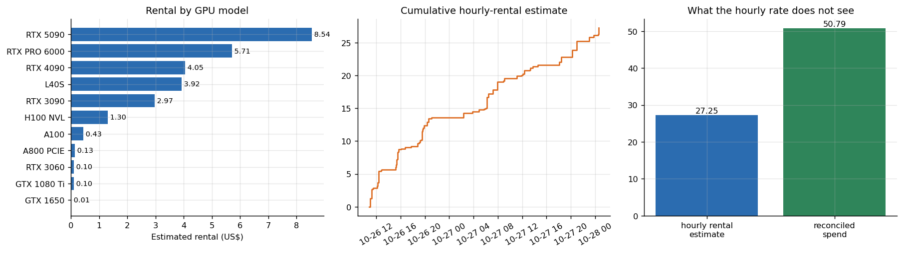
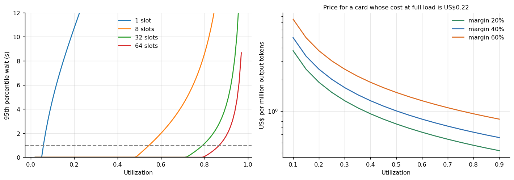

# Vast.ai GPU benchmark harness

**How to benchmark on rented GPUs without losing the budget to retries and orphaned instances.** This repository holds the orchestration code, the cost ledger and the pricing model behind a 20-article study of 8 GPU models (RTX 3090, 4090, 5090, L40S, A100, H100 NVL, RTX PRO 6000 and an ARM GB10). Every other repository of the series ran on top of it.



## Why this matters

Renting GPUs by the hour makes benchmarking cheap and makes mistakes expensive in a quiet way: an instance that outlives its script, a host whose download traffic is billed per terabyte, a boot that never finishes. In this campaign the reconciled spend was **US$ 50.79**, while the hourly price of every instance times its lifetime only explains **US$ 27.25** of it, a factor of **1.86**. The rest is what a price list does not show: sessions logged late, traffic, storage and instances that ran before the ledger knew about them. The harness exists so that this gap is measured and bounded instead of discovered afterwards.

## What is in here

| Part | What it does |
|---|---|
| `src/eco/vast.py`, `lease.py` | Vast.ai API client and the life cycle of one paid session (create, wait for SSH, run, download, destroy) |
| `src/eco/guard.py`, `watchdog.py`, `budget.py` | Three independent safety nets: a credit guard that destroys instances under a floor, a watchdog that destroys instances no script owns, and an append-only ledger |
| `src/eco/campaign.py`, `session_script.py` | Offer filters (reliability, bandwidth, CUDA, disk, download price), preflight checks and the launcher |
| `src/eco/aggregate.py`, `qsim.py`, `pricing.py`, `finance.py` | Turn raw logs into summary tables, simulate a queue with measured service times, compute cost per unit |
| `analysis/` | Reproducible analysis of the cost ledger and of the pricing model (figures and tables in `results/`) |
| `analysis/benchkit.py` | Small statistics library (Wilson and bootstrap intervals, McNemar, Erlang C, additive log fit) shared by all repositories |
| `tests/` | Unit tests of the statistics and checks of the published numbers against the raw data |

## Results

### The ledger

166 rented instances, 43.5 instance-hours, US$ 27.25 of hourly rental. The most expensive GPU model was the **RTX 5090** at US$ 8.54. The median hourly price paid was US$ 0.497. Sessions that ended early (status `partial`, an error or the budget guard) account for 14.5% of the rental money. See `results/tables/rental_by_gpu.md` and `rental_by_status.md`.

### From a benchmark to a price per unit

A price needs more than a speed. `analysis/pricing_model.py` takes the service time measured on the language model server (median 6.19 s per request) and asks how busy a pool of slots can be while the 95th percentile queueing delay stays under one second (Erlang C):

| Slots in the pool | Highest utilization |
|---|---|
| 1 | 5.5% |
| 8 | 54.5% |
| 32 | 79.0% |

A lone server must idle most of the time to keep waits short; a pool of 32 can run at about four fifths. Because price per unit scales with 1 / utilization, pooling is worth more than a faster card. For the cheapest card that met the service level (an RTX 5090, US$ 0.22 per million output tokens at full load) the price formula gives US$ 0.64 per million tokens at the 32-slot ceiling with a 5% failure share, 30% overhead and 40% margin.



## Safety design, in one paragraph

Every session registers a lease with a time to live in the append-only ledger, and the session script destroys its instance when it finishes. If the script dies, the watchdog (a separate process) destroys the instance when its lease expires or the budget is exceeded, and also destroys instances that carry the campaign label but have no lease, after a 120 second grace period (an earlier version had no grace period and once destroyed a healthy instance 1.5 seconds after creating it). A third process, `guard.py`, polls the account balance and destroys every campaign instance if it falls under a floor. In the campaign the guard stopped one run on purpose, a 3D reconstruction that was a few minutes from finishing: that is the price of not trusting any single script.

## Reproduce

```bash
make setup      # pandas, numpy, matplotlib, pytest
make analysis   # regenerates results/figures and results/tables from data/
make test       # statistics unit tests + checks of the published numbers
```

Running a new session needs a Vast.ai API key in the environment (`VAST_API_KEY`), an SSH key and a budget (`BUDGET_BRL`, `SOFT_STOP_BRL`). Nothing in this repository contains credentials.

## Limits

The ledger holds hourly estimates, and the reconciled total comes from the account balance; per-session reconciliation is not available for every row. Prices are marketplace prices on two days of October 2026 and change by the hour. The queue model assumes random arrivals and exponential service times, which real traffic does not follow exactly.

## Articles that use this repository

- [What a GPU benchmark campaign really costs](https://www.kaggle.com/code/lucasrangelss/what-a-gpu-benchmark-campaign-really-costs): the full cost story, every waste and every fix
- [From a benchmark to a price per unit](https://www.kaggle.com/code/lucasrangelss/from-a-benchmark-to-a-price-per-unit): the pricing model above in depth
- Data: [Kaggle dataset gpu-ai-benchmark-campaign-2026](https://www.kaggle.com/datasets/lucasrangelss/gpu-ai-benchmark-campaign-2026)

Licence of this code: MIT. Third-party tools and weights keep their own licences, listed in `LICENSE_NOTES.md`.
